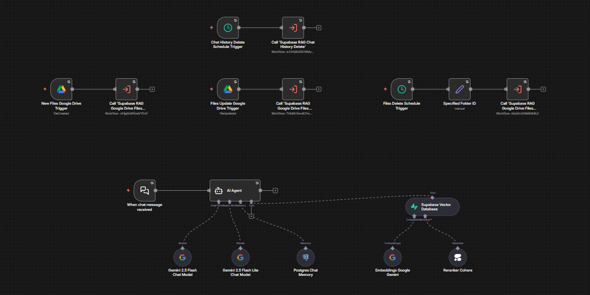
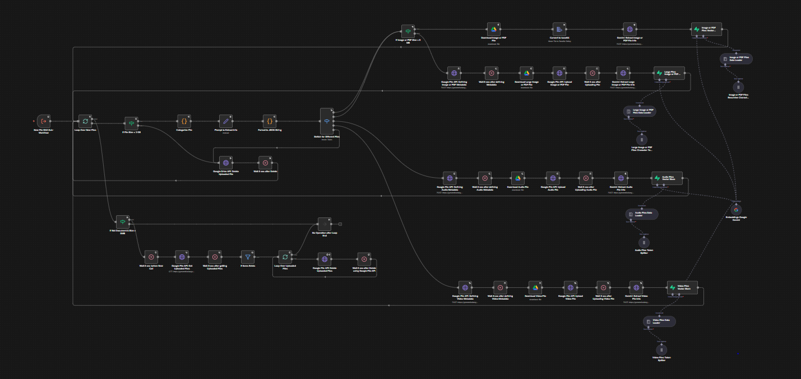
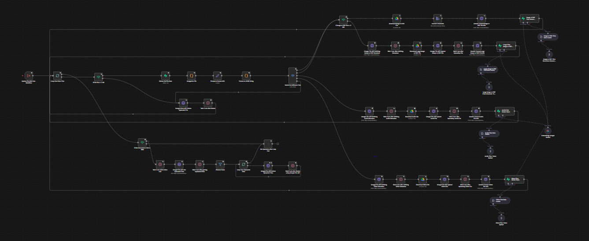
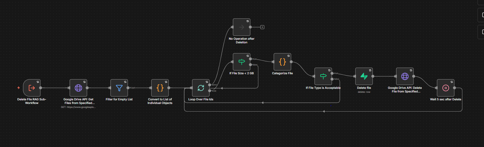
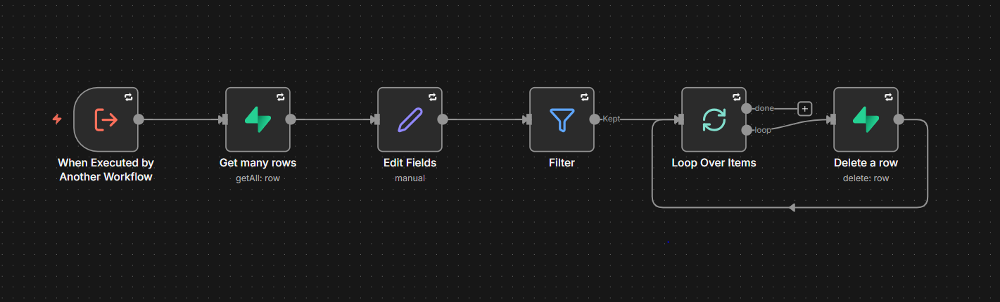

# Supabase RAG Chat Agent with Google Drive Knowledge Sync

A set of n8n workflows that answers questions from a Supabase vector database and keeps that database in sync with a Google Drive folder. Separate workflows ingest, update and delete file content, and a cleanup workflow removes old chat history.

## Overview

The AI Chat Agent workflow answers chat messages by searching a Supabase vector store that holds extracted file content. Handler workflows watch Google Drive or run on a schedule, and each one calls a sub-workflow that does the work. The Ingest and Update sub-workflows use the Gemini API to turn PDFs, images, audio and video into text, then store that text as vectors in Supabase. The Delete sub-workflow removes vectors and Drive files, and the Chat History Delete sub-workflow removes old rows from the Postgres-backed chat table.

## Workflows

| Workflow | Trigger | Purpose |
| --- | --- | --- |
| Supabase RAG AI Chat Agent | Chat trigger | Answers chat messages from the Supabase vector store. |
| Supabase RAG Google Drive Files Ingest Handler | Google Drive Trigger (file created) | Starts the Ingest sub-workflow when a file is added to the watched folder. |
| Supabase RAG Google Drive Files Ingest | Execute Workflow Trigger | Extracts file content with Gemini and stores it in Supabase. |
| Supabase RAG Google Drive Files Update Handler | Google Drive Trigger (file updated) | Starts the Update sub-workflow when a file in the watched folder changes. |
| Supabase RAG Google Drive Files Update | Execute Workflow Trigger | Replaces the stored content of a changed file. |
| Supabase RAG Google Drive Files Delete Handler | Schedule Trigger (every 2 minutes) | Starts the Delete sub-workflow for a specified folder. |
| Supabase RAG Google Drive Files Delete | Execute Workflow Trigger | Deletes vectors and Drive files for the specified folder. |
| Supabase RAG Chat History Delete Handler | Schedule Trigger | Starts the Chat History Delete sub-workflow. |
| Supabase RAG Chat History Delete | Execute Workflow Trigger | Deletes chat history rows that are at least one day old. |

## Workflow Details

### Supabase RAG AI Chat Agent

This workflow answers each chat message in one sentence with a source citation, using only content retrieved from Supabase.

Trigger: the n8n Chat Trigger receives a chat message.

1. The AI Agent node receives the message and the session identifier.
2. Postgres Chat Memory loads the last 10 messages for that session.
3. The agent calls the Supabase Vector Database tool, which searches the `rag_docs_db` table and returns the top 10 matches.
4. Cohere reranks the matches, and Cohere embeddings (`embed-multilingual-v2.0`) encode the query.
5. An OpenAI chat model writes the answer.

The system message tells the agent to reply with "No relevant information found in the knowledge base." when retrieval returns nothing.

Integrations: OpenAI, Cohere, Supabase, Postgres.

### Supabase RAG Google Drive Files Ingest Handler

This workflow passes new Google Drive files to the Ingest sub-workflow.

Trigger: the Google Drive Trigger polls one watched folder every minute for created files.

1. An Edit Fields node passes the trigger data on.
2. An Execute Workflow node calls Supabase RAG Google Drive Files Ingest.

Integrations: Google Drive.

### Supabase RAG Google Drive Files Ingest

This workflow converts new Drive files to text with Gemini and stores the text in Supabase.

Trigger: an Execute Workflow Trigger starts the run, called by the Ingest Handler.

1. Loop Over New Files processes the incoming files one at a time.
2. If File Size < 2 GB checks the size. Larger files are deleted from Google Drive, followed by a 5 second wait.
3. A Code node assigns the file a category (pdf, image, audio, video or other) from its extension.
4. A Set node builds an extraction prompt, and a Code node converts it to a JSON string.
5. A Switch node routes the file by category.
6. Image and PDF files go through If Image or PDF Size < 5 MB. A file under 5 MB is downloaded from Google Drive, converted to base64 and sent to Gemini 2.5 Flash. A larger file is uploaded through the Gemini File API and then sent to Gemini 2.5 Flash.
7. Audio and video files are downloaded from Google Drive, uploaded through the Gemini File API and sent to Gemini 2.5 Flash.
8. A Supabase Vector Store node inserts the extracted text into `rag_docs_db`, using Google Gemini embeddings. The data loader records the file ID, file name and date added as metadata.
9. Text splitters set the chunk overlap to 200: Recursive Character for images and PDFs, Token for audio and video, and Character for large images and PDFs.
10. Files in the "other" category are deleted from Google Drive.
11. After the loop finishes, a file category other than document with a size from 5 MB up to 2 GB leads to cleanup. The workflow lists the files uploaded to the Gemini File API and deletes them in a second loop, waiting 5 seconds between calls.

Integrations: Google Drive, Gemini API, Supabase.

### Supabase RAG Google Drive Files Update Handler

This workflow passes changed Google Drive files to the Update sub-workflow.

Trigger: the Google Drive Trigger polls one watched folder every minute for updated files.

1. An Edit Fields node passes the trigger data on.
2. An Execute Workflow node calls Supabase RAG Google Drive Files Update.

Integrations: Google Drive.

### Supabase RAG Google Drive Files Update

This workflow replaces the stored vectors of a changed file with freshly extracted content.

Trigger: an Execute Workflow Trigger starts the run, called by the Update Handler.

1. Loop Over New Files processes the incoming files one at a time.
2. If File Size < 2 GB checks the size. Larger files are deleted from Google Drive.
3. A Supabase node deletes the existing `rag_docs_db` rows whose file name matches the changed file.
4. The remaining steps match the Ingest workflow: categorize, build the prompt, route by file type, extract text with Gemini 2.5 Flash, split the text and insert vectors into Supabase.
5. Files in the "other" category are deleted from Google Drive, and Gemini File API uploads are cleaned up after the loop.

Integrations: Google Drive, Gemini API, Supabase.

### Supabase RAG Google Drive Files Delete Handler

This workflow starts the Delete sub-workflow on a fixed schedule.

Trigger: a Schedule Trigger runs every 2 minutes.

1. A Set node assigns the Google Drive folder to process.
2. An Execute Workflow node calls Supabase RAG Google Drive Files Delete.

Integrations: Google Drive.

### Supabase RAG Google Drive Files Delete

This workflow removes the files in a folder from both the Supabase vector store and Google Drive.

Trigger: an Execute Workflow Trigger starts the run, called by the Delete Handler.

1. The Google Drive API lists the non-trashed files in the folder.
2. Filter for Empty List stops the run when the folder has no files.
3. A Code node converts the list into one item per file, and Loop Over File Ids processes them one at a time.
4. If File Size < 2 GB skips larger files.
5. A Code node assigns the file a category, and If File Type is Acceptable accepts pdf, image, audio and video files only.
6. A Supabase node deletes the `rag_docs_db` rows whose metadata contains the file ID.
7. The Google Drive API deletes the file, and the workflow waits 5 seconds before the next file.

Integrations: Google Drive, Supabase.

### Supabase RAG Chat History Delete Handler

This workflow starts the chat history cleanup on a schedule.

Trigger: a Schedule Trigger.

1. An Edit Fields node passes the trigger data on.
2. An Execute Workflow node calls Supabase RAG Chat History Delete.

### Supabase RAG Chat History Delete

This workflow deletes chat history rows that are at least one day old.

Trigger: an Execute Workflow Trigger starts the run, called by the Chat History Delete Handler.

1. A Supabase node reads all rows from the `n8n_chat_histories` table.
2. An Edit Fields node calculates `daysPassed` from each row's `time` value.
3. A Filter node keeps rows where `daysPassed` is 1 or more.
4. Loop Over Items passes the rows to a Supabase node, which deletes each row by its `id`.

Integrations: Supabase.

## Integrations

- Supabase (vector store, chat history table)
- Google Drive
- Gemini API (Gemini 2.5 Flash, Gemini File API, embeddings)
- OpenAI
- Cohere
- Postgres

## Prerequisites

- An n8n instance with the AI, Supabase, Google Drive and Postgres nodes.
- A Supabase project with the `rag_docs_db` table, the `match_rag_docs_db` query function and the `n8n_chat_histories` table.
- A Supabase API credential.
- A Postgres credential for chat memory.
- A Google Drive OAuth2 credential.
- A Google Gemini (PaLM) API credential for embeddings.
- An HTTP header authentication credential for Gemini API requests.
- An OpenAI API credential.
- A Cohere API credential.

## Setup

1. Import each JSON file from the `workflows` directory into n8n.
2. Create the credentials listed under Prerequisites.
3. Assign the credentials to the nodes that use them.
4. Set the watched folder in both Google Drive Trigger nodes and the folder in the Specified Folder ID node.
5. Open each Execute Workflow node in the handler workflows and select the matching imported sub-workflow.
6. Open the settings of each workflow and assign your own error workflow, or clear the setting.
7. Review the node parameters, then activate the handler workflows and the AI Chat Agent workflow.
